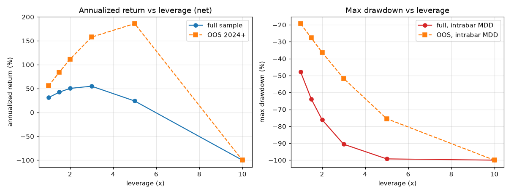

# 杠杆倍数 vs 年化 研究报告 v1.0

**脚本**: `research/oos/leverage_v1_0.py`；引擎 `s1_engine_v1_1.py`（v1.0 的执行语义 + 强平 + 盘中回撤）  
**口径**: 净口径（扣 0.05%/边 + 资金费），逐仓强平 MMR 0.5%，30U 起始；OOS 为 2024-01-01 起重启  
**回撤**: `盘中` = 持仓期间最差 MTM（主口径）；`平仓` = 仅平仓后权益（v1.0 口径，偏乐观）

## 1. 全样本（2020-01 ~ 2026-10）

| 杠杆 | 期末 | 年化 | 盘中最大回撤 | 平仓口径回撤 | Calmar | 强平次数 | 是否爆仓 |
|---|---|---|---|---|---|---|---|
| 1.0x | 181.1U (6.04x) | +31.0% | -47.7% | -46.8% | 0.65 | 0 | 否 |
| 1.5x | 315.1U (10.50x) | +42.4% | -63.9% | -63.3% | 0.66 | 0 | 否 |
| 2.0x | 451.5U (15.05x) | +50.3% | -76.1% | -75.6% | 0.66 | 0 | 否 |
| 3.0x | 550.9U (18.36x) | +54.9% | -90.6% | -90.3% | 0.61 | 0 | 否 |
| 5.0x | 124.9U (4.16x) | +23.9% | -99.2% | -99.2% | 0.24 | 0 | 否 |
| 10.0x | 0.0U (0.00x) | -100.0% | -100.0% | -100.0% | -1.00 | 1 | 是 |

## 2. 样本外（2024-01 ~ 2026-10，30U 重启）

| 杠杆 | 期末 | 年化 | 盘中最大回撤 | Calmar | 强平次数 | 是否爆仓 |
|---|---|---|---|---|---|---|
| 1.0x | 100.1U (3.34x) | +55.6% | -19.3% | 2.88 | 0 | 否 |
| 1.5x | 158.6U (5.29x) | +84.2% | -27.8% | 3.03 | 0 | 否 |
| 2.0x | 231.6U (7.72x) | +111.6% | -36.3% | 3.08 | 0 | 否 |
| 3.0x | 396.4U (13.21x) | +157.7% | -51.7% | 3.05 | 0 | 否 |
| 5.0x | 526.6U (17.55x) | +186.0% | -75.5% | 2.46 | 0 | 否 |
| 10.0x | 0.0U (0.00x) | -100.0% | -100.0% | -1.00 | 1 | 是 |

